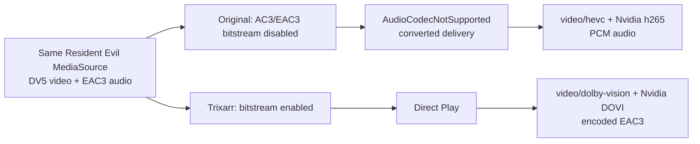

# Playback comparison — Resident Evil

Datum: 2026-11-10. Två sekventiella körningar på samma Shield. Ingen appinställning ändrad.
**DEVICE VERIFIED** avser observerat Android-/app-/loggtillstånd. **USER VERIFIED** avser
uttrycklig fysisk observation. **NOT VERIFIED** betyder att sådan evidens saknas.
Samlad fysisk färg-/HDMI-jämförelse: **INCONCLUSIVE** i väntan på användarobservation.
Historisk rotorsak: **UNKNOWN**; aktuell leverans-/konfigurationsskillnad är belagd.

## Media equivalence gate

| Dimension | Original Jellyfin J01 | Trixarr T01 | Verdict |
| --- | --- | --- | --- |
| Serverorigin, SHA-256 av scheme/host/port utan credentials | fa6a38f6dd8c8e9924bbcdbcf36f1e757a3a25c4f0403429b9185576859eb0b6 | Same | DEVICE VERIFIED same origin; ServerId not separately read |
| Media item | dae676fc-22d2-a272-784e-30b9ff521ab8 | Same | DEVICE VERIFIED |
| MediaSourceId | dae676fc22d2a272784e30b9ff521ab8 | Same | DEVICE VERIFIED |
| Source video | Same source, default video; independent J01 source index not printed | Source metadata video#0 only, HEVC Main10, DV5 L6, 3832×1600, 23.976025 fps | Same source video inferred from unique video track; direct independent J01 index confirmation NOT VERIFIED |
| Source audio | Requested/default index1 | Default/selected source index1 | DEVICE VERIFIED same source track; delivered audio differs |
| Raw file hash / MediaSource binary immutability | Not read | Not read | NOT VERIFIED; no large file copy |

Detta är en verifierad serverorigin/item/MediaSource-/ljudspårmatchning, inte en
bytehash av källfilen. Om oberoende videoströmsindex eller filhash krävs som strikt
equivalence gate är den delen **INCONCLUSIVE**. Ingen slutsats bygger enbart på titeln.
Postens UI-datum/artwork kan vara felmatchade; ID och teknisk metadata identifierar provet.

[Originalidentitet](J01-media-identity.json), [Trixarridentitet](T01-media-identity.json).
URL:er och auth-parametrar sparas inte; endast vitlistade tekniska fält/ID och serverhash.

## Observed execution

| Field | Original Jellyfin J01 | Trixarr T01 |
| --- | --- | --- |
| Package/version | org.jellyfin.androidtv / 0.19.10 | se.viktorjonsson.jellyfintv.debug / 0.0.0-dev.1 |
| Media3 runtime | 1.8.0, Init/Release | 1.8.0, Init/Release/dialog |
| Start requested UTC | 19:57:19 | 20:04:54 |
| Decoder init UTC | 19:57:20.768 | 20:04:57.457 |
| Delivery | Transcode; controller Play method: Trans | DirectPlay; static=true; controller Play method: Direct |
| Negotiation reason | AudioCodecNotSupported | No transcode reason; original file delivery |
| Requested audio codec alternatives | aac,mp3 | No conversion requested in static media URL |
| Video decoder | OMX.Nvidia.h265.decode | OMX.Nvidia.DOVI.decode |
| Configured decoder MIME | video/hevc, native media.metrics after release | video/dolby-vision, native media.metrics + Media3 snapshot |
| Media3 video codec string | NOT VERIFIED | dvhe.05.06 |
| Delivered DV profile/level | NOT VERIFIED; not inferred from source badge | (5,6) |
| Source container | Same MediaSource as T01; no independent source metadata dump | MKV, HEVC Main10/10-bit, 3832×1600, 23.976025 fps |
| Source HDR metadata | P5 source equivalence; UI has Dolby Vision badge (metadata only) | Jellyfin DOVI/P5/L6; primaries/transfer/matrix UNKNOWN |
| MediaFormat/HDR | Full input/output MediaFormat/CSD/RPU not captured | video/raw output, static-info key present; input video/dolby-vision; raw CSD/RPU not captured |
| Android Surface | NativeWindow 3832×1600, color0x106→0x10b | ExoPlayer-managed Surface; DV-specific ACodec attributes logged |
| Actual audio decoder | NOT VERIFIED | UNKNOWN in dialog; encoded AudioTrack selected |
| Delivered compressed audio | NOT VERIFIED; AAC/MP3 were requested, not independently confirmed as actual payload | audio/eac3, 6 channels,48 kHz |
| Android AudioTrack | PCM16,48 kHz,native channelMask63,frameCount12000 | EAC3,48 kHz,native channelMask63,frameCount192000; Java config mask252 |
| Passthrough | No encoded output in native AudioTrack records | Encoded EAC3 output selected; HDMI receiver observation still required |
| Duration / stop position | 94371 ms; brief pause/resume within test | 91681 ms; end snapshot91683 ms |
| Dropped frames | NOT VERIFIED; no matching counter captured | 0 cumulative in end snapshot |
| Buffering | Initial buffering then playback; continuous buffer history NOT VERIFIED | End buffered37756 ms; READY/PAUSED |
| Errors | No named playback/decoder failure in retained excerpts; AudioTrack dead/recreation warning occurred | Error fields UNKNOWN; no named failure in captured excerpts |
| Audio underruns | Final AudioTrack stop records underrun=0; not a global decoder/frame counter | AudioTrack stop records underrun=0 |
| Stop UTC | 19:59:12.865 | 20:06:44.287 |
| ExoPlayer Release UTC | 19:59:12.886 | 20:06:44.307 |

Ingen parallell uppspelning. Originalet var stoppat/released innan Trixarr startades.
MIME är belagd från den släppta codeccykelns metrics, inte gissad enbart från decodernamnet.
AudioTrack channelMask anges i olika API-lager: native63 och Java252 jämförs inte som
om de vore samma numeriska namnrymd. Inget Atmos-/DTS:X-resultat härleds från metadata.

[J01 loggutdrag](J01-logcat.txt), [J01 metrics](J01-media-metrics.txt),
[T01 loggar](T01-logcat.txt), [T01 metrics](T01-media-metrics.txt),
[T01 start](T01-start-diagnostics.txt), [T01 paus/end](T01-end-diagnostics.txt).

## Read-only settings comparison

| Setting | Original Jellyfin | Trixarr | Interpretation |
| --- | --- | --- | --- |
| Bitströmma Dolby Digital-ljud | Unchecked / false | Checked / true | Confirmed relevant difference; code flag ac3Enabled controls both AC3 and EAC3 in profile |
| Audio output | Direkt | Not independently inspected in Trixarr's first settings page | Do not infer downmix setting from codec alternatives alone |
| Automatic night mode | Unchecked | Unchecked | No observed difference |
| Refresh switching | Skala på enheten | Skala på enheten | Same existing mode policy for this comparison |
| Max bitrate | 200 Mbit/s | 200 Mbit/s | No observed limit difference for this 24.2 Mbit/s source |
| Start delay | 0.0s | 0.0s | No observed difference |
| Live TV direct stream | Unchecked | Checked | Unrelated to this VOD file |

UI navigerades utan att någon checkbox/radioknapp eller slider ändrades. Report-device-
profile-knappen aktiverades inte. Inga kontodatabaser/preferences/credentials lästes ut.
[J01 inställningar](J01-observed-settings.json), [T01 inställningar](T01-observed-settings.json).
Vem/när en lagrad inställning ändrats är inte fastställt.

## Display and physical output

| Evidence | Original J01 | Trixarr T01 |
| --- | --- | --- |
| Before playback | Android mode49,3840×2160/59.94006 Hz | Android mode49,3840×2160/59.94006 Hz |
| Requested during | Existing controller requests mode40 | Existing controller requests mode40 |
| Observed during | mode40,23.976025 Hz | End dialog mode40,23.976025 Hz; early dialog still showed49 before update |
| After stop | mode49 observed UTC19:59:23 | Immediate post-stop sample40; mode49 observed UTC20:07:18 |
| TCL active DV/HDR | NOT VERIFIED in this new run | NOT VERIFIED in this new run |
| Correct/incorrect physical colors | NOT VERIFIED in this new run | NOT VERIFIED in this new run |
| Yamaha incoming format | NOT VERIFIED in this new run | NOT VERIFIED in this new run |
| Physical smoothness | NOT VERIFIED | NOT VERIFIED |

Mode49/40 mappings come from Android's actual supported modes. An observed Android mode
is not independent verification of TV signal metadata. These after-stop samples do not
measure exact switch/restore latency. No Android global display setting was changed.

The previous Resident Evil test has **USER VERIFIED** correct colors, TCL Dolby Vision
logo and Yamaha DD+, confirmed explicitly in the profile-matrix task. That observation
is historical baseline, not a fabricated fresh observation for either J01 or T01.
Screen capture is not used to judge physical DV colors; prior captures could look pink
while the TV picture was correct.

Both apps now have existing refresh switching enabled, unlike the earlier Trixarr matrix
where59.94Hz remained throughout. The changed stored-state history is UNKNOWN. This task
made no setting changes; the unfinished refresh implementation was not deployed.

## Most supported current explanation

Arrows describe the code-backed negotiation path and observed outputs. They do not prove
where RPU/DV configuration is lost or whether video was copied/reencoded server-side.
The suspected failure boundary is the different converted media path/signaling reaching
Media3, not a different video engine. A matched-settings intervention would strengthen
causal attribution but requires separate authorization and was not performed.

## Root cause hypotheses A–J

| Hypothesis | Supporting evidence | Contradicting evidence / limitation | Confidence | Next verification |
| --- | --- | --- | --- | --- |
| A Different Media3 version | None for this pair | Both runtime1.8.0 and source catalog1.8.0 | High confidence against current-version explanation | Historical app APK/version if diagnosing an older incident |
| B Different codec selection | Native DOVI/DV MIME versus h265/HEVC MIME | Different input/delivery; not an isolated selector-order test. Media3 already excludes explicit P5 HEVC fallback | High for observed decoder difference; low for selector code as root cause | Match delivery/input and inspect selected Format/CSD without codec override |
| C Different MediaSource | Fork has explicit version-selection code | Same serverorigin,item,MediaSourceId,source audio1 | Low for different current source; raw hash/index caveats remain | Independent source-video index/file hash if stricter identity required |
| D Different DirectPlay/transcode policy/path | J01 Transcode AudioCodecNotSupported; T01 static DirectPlay | Negotiation/profile code itself byte-identical; stored flag differs | High for path difference | Separately authorized matched-settings A/B and read-only server decision/FFmpeg evidence |
| E Different HDR metadata handling | J01 configured video/hevc, T01 explicit dvhe.05.06 + DV attributes | Same Media3/extractor code; raw delivered container/DV CSD/RPU not examined | Medium for delivery/signaling boundary; exact mechanism UNKNOWN | Compare converted/original container signaling and server copy/encode decisions without copying large files |
| F Different Android display configuration | Historical matrix had different Trixarr rate | Current apps both request/observe23.976, restore59.94; HDR support same | Low for current rate difference; HDMI state unobserved | Physical TV HDR/DV observations with current matching display modes |
| G Different application settings | Original bitstream false, Trixarr true; source flag excludes EAC3; server explicitly cites audio compatibility | No matched-settings intervention, historical setting history unknown | High for current negotiation trigger; not final historical color proof | Separate approved bitstream setting A/B, then restore original value |
| H Different tracks | Different delivered audio and video MIME | Same requested source audio1 and same source; video#0 uniqueness inference | Low for source-track mismatch; high for downstream conversion | Independent original source video index and actual delivered audio Format |
| I Different media file | No raw file hashes | Same item/MediaSourceId and matching source geometry | Low for current source mismatch; not cryptographic equality | Read-only file hash/MediaSource metadata if already authorized and accessible |
| J Unknown | Historical bad-color event has no paired trace; fresh TV/AVR observations absent | Current configuration/path divergence is strongly documented | Historical full root cause UNKNOWN | User physical comparison plus controlled matched-settings test |
